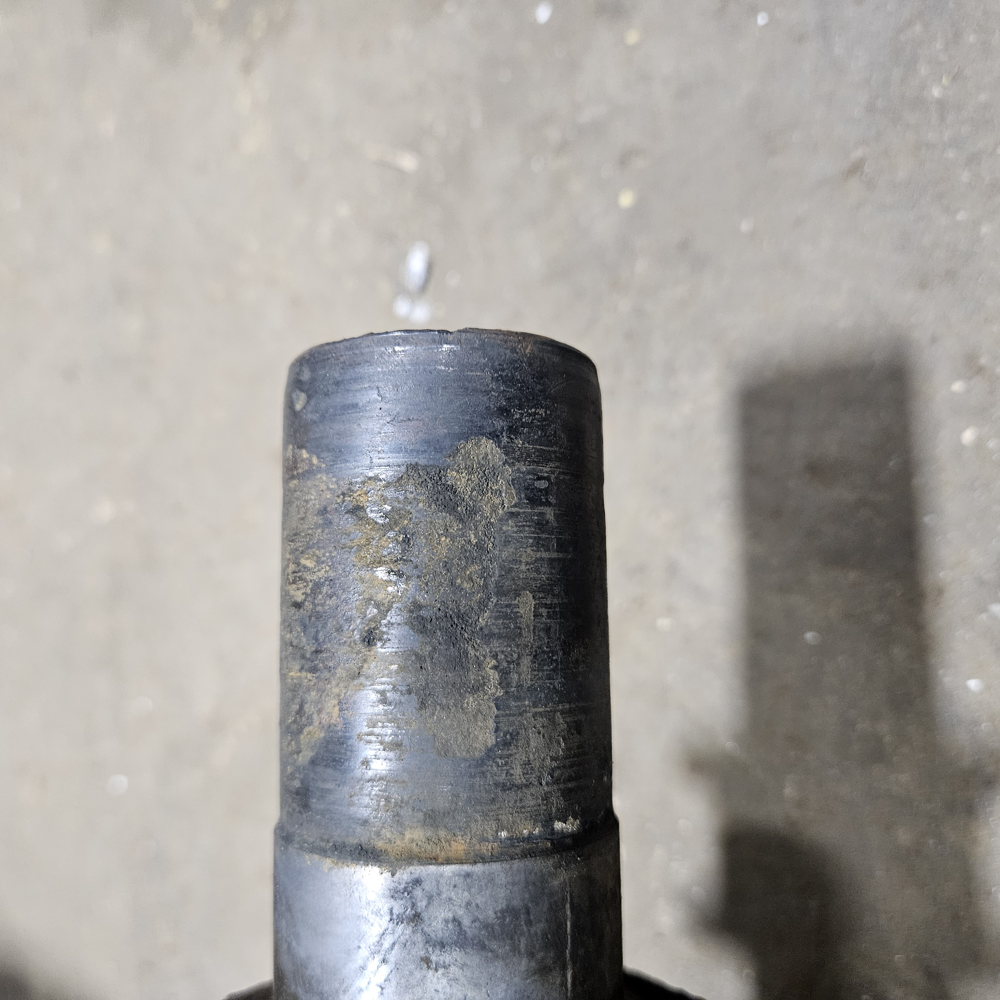

<a href="/about/#wastewater-treatment-facility-wwtf">About our Wastewater Treatment Facility</a>
(WWTF).

SID Board of Trustees - I am requesting votes of concurrence to move forward
with the attached quote for an additional $2,966.12 to replace the two bottom
shafts for the clarifier.  I thought the bottom shafts were likely to need
replaced, but I was unable to assess their condition (see attached pictures)
until the clarifier was cleaned by vendor1 this week.  I would like to move
forward with this quickly so that we can get the shafts ordered and get this
system operational.
  
The other attached quote of $3,140.97 is for a full set of spare wear plates
and skid connection links.  Whereas, I think this may be a good investment for
the SID, that decision can wait and we could decide to order the spares after
both the clarifier and sinkhole are repaired if we want to assess our financial
situation at that point.

The cleaning of the clarifier by vendor2 went much quicker than vendor1 and I
expected.  The invoice for that service was $780, which was less than I
initially had estimated.

*[ Any homeowner can request a copy of these quotes from any Board Member, or our SID Lawyer. ]*

---

See attached estimates.  One is for the spare parts as we discussed.

The other is for replacing the worn bottom shafts that we discovered once the
pit was cleaned and shafts were removed.  So far this is the fastest option to
get the new shafts in Stainless Steel.  The only draw-back to this option is
that the shafts come with a pre-machined keyway along the full length.  A few
consequences I see from this are: reduces the overall strength of the shaft
(however I feel the SS compared to existing carbon steel offsets this for the
most part).  The keyway could also promote rope, fabric, plastic, wire, etc to
snag and wrap around the shaft.  Perhaps neither of these are a concern to the
district, just sharing my thoughts.

I am waiting for price/availability for Option 2, consisting of custom cut
keyways for the sprocket locations. 

I have also attached photos of the existing ends on the bottom shafts for your
reference.

<a href="/about/#wastewater-treatment-facility-wwtf">About our Wastewater Treatment Facility</a>
(WWTF).

